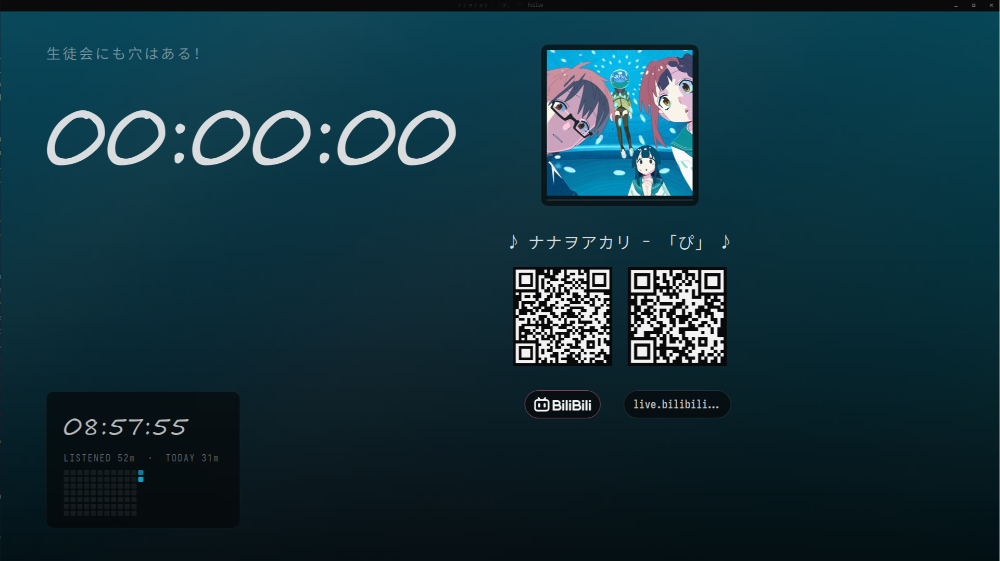

<div align="center">


# Follow

**一个把「正在听什么」摆到屏幕上给观众看的极简音乐播放器。**

</div>




## 功能

### 播放

- 本地文件、`http(s)` 直链、HLS 都能放（FFmpeg 解码）
- **Bilibili / YouTube 链接直接粘**：`BV` 号、`av` 号、`b23.tv` 短链、`youtu.be`、
  `watch?v=` / `shorts` / `music.youtube.com` 都会自动解析出音频轨（YouTube 需要代理）
- 播放 / 暂停 / 停止 / 拖动进度 / 上一首下一首
- 循环（关 · 列表 · 单曲）、随机（带历史，「上一首」真的能回去）、自动续播
- **音量 / 静音 / 输出设备**：命令面板里调，音量、静音状态和输出设备都会记住
- 全键盘操作，没有按钮也没有菜单

### 画面

- **动态背景**：封面模糊打底 + 从封面里取的三团种子色缓慢漂移，随换曲一起换色
- **音频粒子背景**：`[visualizer] effect = dust / warp / flow` 三套预设，采样真实播放的音频做 1024 点 FFT，低频 / 中频 / 高频分别驱动粒子的速度、大小和亮度；颜色取自封面，画在压暗层之前，不会盖住文字
- **换曲过渡**：旧背景「退潮」左移滑走，新组件「撤桌重上」从右侧推入；两层故意不同步，看起来像两次动作而不是整块搬走
- **自适应版面**：字号和位置全部按窗口尺寸算，1920×1080 到小窗口、窗口宽度窄到两栏要撞时都会自动收，时钟太长会自己缩字号
- 两种字体：界面是 Iosevka + Noto Sans SC，只有时间用手写体

### 歌词

- 标准 LRC：`[mm:ss.xx]`、`[offset:]`、一行多时间戳、行内 `<mm:ss.xx>`
- 自动识别编码（GB18030 的老 LRC 也能读）；没写 `lrc=` 就在音频旁边找同名 `.lrc`
- **在线歌词**：`lrc=netease:李荣浩 耳朵` / `lrc=qq:186016`，取回带时间轴的歌词并缓存，重复播放不再联网
- 取回后还会检查「音频和歌词时长差太多」并提示换源
- **歌词偏移**：`[` / `]` 边听边调 250 ms，`\` 复原 —— 视频带片头的情况很好用

### 歌曲墙

- `Tab` 打开全屏歌曲墙：`12 × 8` block 模板向四周无限重复，每个新 block 随机换模板 / 翻转 / 打乱曲序，拖到哪都有内容（布局思路参考 Folia，槽位和实现是自己的变体）
- 鼠标左键自由拖动（松手带惯性），滚轮 / 触摸板双指平移；拖完自动把焦点落到视野内最近的磁贴
- 墙层走 `GtkGLArea`：cairo 只负责把每首歌按尺寸预渲染成纹理，平移 / 选中弹出 / 压暗 / 淡入由 GPU 合成；驱动不支持 OpenGL 3.3 时自动退回整屏 cairo，也可以用 `FOLLOW_WALLGL=0` 强制回退
- 整屏置色：底色 + 两团来自选中封面的径向柔光（Folia 的做法），顶栏 / 底栏都是同色相的实心色衬；focus 封面还没加载完时保持上一色，不会闪黑
- 封面磁贴：大封面 + 底部渐变标题 / 艺人、右上角平台角标；当前曲目左侧强调条 + `♪`，选中的磁贴是白色描边
- `← ↑ ↓ →` 空间导航，`PageUp` / `PageDown` 翻一屏，`Home` / `End` 首尾，`Enter` 或 `Space` 播放并返回
- 进场 / 退场、磁贴弹出、封面淡入都能用 `[ui] animations = false` 整体关掉（低配机器）
- 不满一个 block 的空位用低对比度 `FOLLOW` 装饰磁贴补齐
- 开关键、关闭键以及所有播放快捷键都能在 `[keys]` 里改

### 性能 / 硬件加速

- **Windows 默认打开 DirectComposition**：GTK 4.24 的 Win32 后端默认不创建 DComp 设备，
  GSK 会一直退回 cairo 软件合成，2K 全屏时每帧都要把 GL 纹理读回内存。程序启动时自动往
  `GDK_DEBUG` 里追加 `dcomp`，GSK 才会用 GL 渲染器。驱动不支持时 GTK 会自己回退；
  想强制关掉可以设 `FOLLOW_DCOMP=0` 或 `GSK_RENDERER=cairo`。
- **歌曲墙**：cairo 只把每首歌预渲染成磁贴纹理，相机平移 / 选中弹出 / 压暗 / 淡入全在
  `GtkGLArea` 里由 GPU 合成；打不开 OpenGL 3.3 或设 `FOLLOW_WALLGL=0` 时退回整屏 cairo。
- **动态背景**：模糊封面只生成一次，三团漂移光斑、音频粒子和压暗全部在 shader /
  加色 sprite 里画；GL 失败或 `FOLLOW_BACKDROPGL=0` 时退回原来的 CPU 小纹理 + `GtkPicture`。
- 封面解码、磁贴纹理生成都放到后台线程 / 低优先级队列；2K / 4K 上磁贴按设备像素渲染，
  打开墙不再同步卡住，快速拖动也不会临时排 Pango。
- Windows 下窗口不再用 CSD 的 12px 阴影（DComp 会把透明阴影区画成黑边）：改成 1px 细边，
  标题栏放在内容顶部用 `GtkWindowHandle` 拖动，四边有自定义缩放；DWM 的圆角 / 边框也关掉。
- `FOLLOW_WALL_DEBUG=1` 会打印墙的帧率 / 帧时间 / 纹理上传数。

> 开发调试：`FOLLOW_WALL_AUTO=1` 启动后自动开墙，`FOLLOW_EXIT_MS=8000` 定时退出，
> `FOLLOW_WALL_AUTO_PAN=1` 持续平移，`FOLLOW_WALL_AUTO_CLOSE` / `FOLLOW_WALL_AUTO_REOPEN`
> 用来复现「开墙 → 关墙 → 再开墙」的性能问题。`FOLLOW_PALETTE_AUTO=1` 自动打开命令面板，
> `FOLLOW_PALETTE_QUERY=vol` 预填查询。

### 二维码

- 网络曲目自动生成一张，下面挂**各家官方字标**（BILIBILI / APPLE MUSIC / YOUTUBE / SPOTIFY / SOUNDCLOUD / BANDCAMP）
- 本地曲目不显示；`[qrcode] link` 是网络地址就再并排一张（扫码进直播间 / 个人主页）
- 两个二维码并排时同一个尺寸，胶囊高度一致

### 左下角统计

- 墙钟、累计收听时长、今日收听时长
- 近 12 周热力图，颜色取自当前封面
- 按天记在 `<cache>/follow/stats.dat`，纯文本，随便改

### 命令面板

`Ctrl+Shift+P` 在右下角打开 VSCode 风格的命令框：输入框在底部，建议列表向上展开，
`↑` / `↓` 选择、`Enter` 执行、`Esc` 或点空白处关闭。可以：

- `Reload config.ini`：重新读取 `src/config.ini`（曲目、按键、可视化、动效）
- `Audio volume...`：+5% / -5% / 50% / 100% / 静音
- `Audio output...`：列出系统播放设备（含 System default），切换后立即生效
- `Visualizer...`、`Toggle animations`、`Cycle repeat mode`、`Toggle shuffle`
- `Lyrics offset` 调整 / 复位、开墙、帮助页、全屏、退出

音量 / 静音 / 输出设备写在 `<cache>/follow/settings.ini`，和 `src/config.ini` 分开，
所以重新加载 ini 不会把音量记忆冲掉。

### 快捷键

| 按键 | 作用 |
|---|---|
| `Ctrl+Shift+P` | 打开 / 关闭命令面板 |
| `Space` | 播放 / 暂停（还没放歌时从第一首开始） |
| `←` / `→` | 后退 / 前进 5 秒（按住 `Shift` = 30 秒） |
| `N` / `P` | 下一首 / 上一首 |
| `R` | 当前曲目从头重放 |
| `S` | 停止 |
| `L` | 循环：关 → 列表 → 单曲 |
| `H` | 随机播放开关 |
| `[` / `]` | 歌词提前 / 延后 250 ms |
| `\` | 歌词偏移恢复成 ini 里的值 |
| `F` / `F11` | 全屏（没有标题栏，就是参考布局那个观感） |
| `Tab` | 打开 / 关闭歌曲墙 |
| `F1` | 快捷键页 |
| `Q` | 退出 |
| `Esc` | 关掉歌曲墙 / 快捷键页 / 退出全屏 |

> 上面只是默认值。所有动作都可以在 `src/config.ini` 的 `[keys]` 组里改，
> 用逗号分隔多个键；`F1` 打开的快捷键页会显示当前实际绑定。

## 开始使用

需要 GTK 4、libepoxy、FFmpeg、libcurl、JSON-GLib、libqrencode、librsvg，以及一个 C 编译器。

```sh
# MSYS2 / MinGW-w64
pacman -S mingw-w64-x86_64-toolchain mingw-w64-x86_64-gtk4 \
          mingw-w64-x86_64-libepoxy mingw-w64-x86_64-libqrencode \
          mingw-w64-x86_64-curl

# Debian / Ubuntu
sudo apt install build-essential pkg-config libgtk-4-dev libepoxy-dev \
     libqrencode-dev libcurl4-openssl-dev libjson-glib-dev librsvg2-dev \
     libavformat-dev libavcodec-dev libswresample-dev libavutil-dev
```

```sh
make          # 产物是 ./main.exe
./main.exe    # 在项目根目录跑：资源路径是相对的
```

配置文件是 `src/config.ini`（[GKeyFile](https://docs.gtk.org/glib/struct.KeyFile.html) 格式，手写），改完直接重启：

```ini
[window]
width=1920
height=1080
title=Follow

[note]
text=Follow                       # 时钟上方那行副标题，可被单曲 note= 覆盖

[qrcode]
link=https://live.bilibili.com/1840990819

[cache]
#dir=cache                        # 缓存目录，默认 <用户缓存>/follow；支持 ~ 和相对路径
#resolve_ttl=2700                 # B 站 / YouTube 解析缓存时长（秒），0 = 关闭
#cover_max_mb=128                 # 封面缓存上限（MB），超出按最近使用清理

[ui]
animations=true                   # 动效总开关：进场 / 退场 / 磁贴弹出 / 封面淡入

[net]
#user_agent=Mozilla/5.0 ...       # 留空就用内置的浏览器 UA
#timeout=15                       # 整次请求超时（秒）
#connect_timeout=5                # 建连超时（秒）
#proxy=http://127.0.0.1:7890      # 代理：YouTube 必填，curl 和 FFmpeg 都走它

[visualizer]
effect=dust                       # off / dust / warp / flow
#particles=150                    # 20 - 400
#gain=1.0                         # 音频灵敏度 0.2 - 4.0

[keys]
play_pause=space
seek_back=Left
seek_forward=Right
next=n
prev=p
restart=r
stop=s
repeat=l
shuffle=h
lyric_earlier=bracketleft
lyric_later=bracketright
lyric_reset=backslash
fullscreen=f, F11                 # 逗号分隔多个键
help=F1
playlist=Tab
back=Escape
quit=q                            # off / none 表示解绑

[audio1]
link=src/assets/xxx.mp3     # 本地路径或 http(s) URL
title=耳朵
artist=李荣浩
pic=src/assets/耳朵.jpg            # 封面：本地路径或 URL
lrc=netease:李荣浩 耳朵            # 本地 .lrc / netease:... / qq:...
#lrc_offset=-7.5                  # 歌词整体偏移（正数 = 歌词延后）
#page=https://www.bilibili.com/video/BV1xx411c7mD   # 二维码目标 + 平台徽标
#note=STAFF CREDITS               # 覆盖 [note] text

[audio2]
link=https://www.bilibili.com/video/BV1GJ411x7h7    # B 站页面链接会自动解析

[audio3]
link=https://www.youtube.com/watch?v=YudHcBIxlYw    # YouTube 页面链接同样会解析
#page=                                             # 二维码目标，默认空则不显示
```

> YouTube 那一路走的是 InnerTube 接口，**国内直连不可用**，需要先在 `[net] proxy` 里填代理。
> 另外 YouTube 会按出口 IP 判人机验证：机房 IP / 公共代理常被挡（界面上会提示
> 「YouTube 要人机验证」），换成住宅 IP 或换个节点即可。
>
> 播放这一路也不走 FFmpeg 自带的 http：googlevideo 现在只接受**定长 Range** 请求，
> FFmpeg 默认发的开放式 `Range: bytes=0-` 会被 403。所以 YouTube 音源改由
> `src/core/httpstream.c` 用 libcurl 按 2MB 分块拉流再喂给解码器，seek 也仍然正确。

`[audioN]` 按 N 排序就是播放列表，任何一项缺失都会回落到默认值，ini 写坏了也能启动。完整的键说明见下方「配置项」。

## 技术栈

一句话：**GTK 4 只负责窗口和输入，整屏画面自己用 cairo 画；音频用 miniaudio 输出、FFmpeg 解码。**

| C + GLib | 全部代码 |
|---|---|
| GTK 4 | 窗口、GtkPicture 纹理放大、CSS、GtkGLArea 歌曲墙 |
| cairo + Pango | 整屏绘制与排版；歌曲墙磁贴预渲染成纹理 |
| OpenGL 3.3 + libepoxy | 墙层 textured quad、相机平移 / 选中缩放 / 压暗在 GPU 上合成 |
| miniaudio | 音频输出设备（已内置，header-only） |
| FFmpeg | 本地 / 网络音频解码 |
| libcurl + JSON-GLib | 网络请求与接口解析（B 站 / YouTube / 歌词源）、YouTube 分块拉流 |
| libqrencode + librsvg | 二维码与品牌矢量图标 |
| 自带 FFT | 可视化用的 1024 点 radix-2 FFT，不依赖 FFTW / libvisual |

---

## 免责声明 / Disclaimer

**本项目仅供学习与技术研究使用。**

- 作者**不提供、不托管、不分发**任何音视频内容。播放的内容全部由使用者自己提供或指定，版权归各自权利人所有。
- `src/core/bilibili.c` 使用 B 站网页端的**非公开接口**并附带 Referer 头来获取音频流地址；
  `src/core/youtube.c` 调用 YouTube 的 InnerTube 接口并伪装成官方客户端；
  `src/core/lyricsrc.c` 同理访问网易云 / QQ 音乐。这些做法**可能违反对应平台的服务条款**，接口也可能随时失效。请仅用于个人学习，不要用于分发、转售或商业用途，也不要下载 / 保存 / 二次分发内容。
- 若需要合规使用，请走各平台官方开放接口，或直接使用你有权访问的音频直链（`http(s)` / HLS）——这条路径不涉及任何平台。
- 使用者须自行遵守所在地法律法规与平台条款，**因使用本项目产生的一切后果由使用者自行承担**。

> This project is for **learning and research only**. It hosts no media content. Third‑party
> services are accessed through undocumented endpoints and may violate their Terms of Service.
> Use at your own risk; the author takes no responsibility for any consequences.

## 配置项

| 组 | 键 | 说明 |
|---|---|---|
| `window` | `width` / `height` / `fullscreen` / `title` | 缺省 800×600、窗口模式、`Follow` |
| `note` | `text` | 时钟上面那行副标题；空则这一行让给歌词 |
| `playback` | `repeat` / `shuffle` | `off`/`all`（默认）/`one`，随机默认关 |
| `qrcode` | `link` / `label` | 只对 `http(s)` 地址显示；`label` 默认取主机名 |
| `cache` | `dir` / `resolve_ttl` / `cover_max_mb` | 缓存目录（默认 `<用户缓存>/follow`）；解析结果缓存时长（秒，默认 2700，0 = 关闭）；封面缓存上限（MB，默认 128） |
| `ui` | `animations` | 动效总开关，`false` 关闭页面滑入 / 滑出、磁贴弹出、封面淡入、背景主色过渡 |
| `net` | `user_agent` / `timeout` / `connect_timeout` / `proxy` | 网络默认值；UA 留空用内置浏览器 UA，超时单位秒，`proxy` 同时作用于 curl 与 FFmpeg |
| `visualizer` | `effect` / `particles` / `gain` | 音频粒子背景：`off` / `dust`（默认）/ `warp` / `flow`，粒子数 20–400，灵敏度 0.2–4.0 |
| `keys` | 动作名 | 按键绑定，值可写多个键（逗号 / 竖线分隔），`off` / `none` 解绑；键名用 GDK 名字，支持 `ctrl+` / `alt+` / `shift+` / `super+` |
| `audioN` | `link` | **必填**，空的组会被跳过 |
| | `title` / `artist` / `note` / `pic` / `lrc` / `lrc_offset` / `page` / `platform` | 同上 |

## 目录结构

```
src/core/    播放器内核：配置、解码与输出、音源解析、歌词、封面取色、收听统计
src/ui/      画面：版面计算、cairo 绘制、动态背景 / 粒子、歌曲墙、二维码、快捷键页
src/icons/   品牌字标 + 本项目 logo
src/style/   GTK 外壳样式（窗口底色 + 极细的标题栏）
src/assets/  示例音频与封面（不入库，按 config.ini 放自己的文件）
src/models/  内置的 miniaudio.h
```

## Roadmap

- [x] 网络音频：FFmpeg + Bilibili / YouTube 解析（页面链接、`b23.tv`、直链、HLS）
- [x] 封面、歌词（本地 + 在线）、二维码、平台徽标
- [x] 循环 / 随机 / 自动续播、收听统计与热力图
- [ ] 更多音源解析（SoundCloud）
- [x] 全屏歌曲墙（无限 block + 自由拖动 / 惯性 / 滚轮，键盘 / 鼠标）
- [x] 解析结果缓存（B 站 / YouTube，TTL + 直链失效自动重解析一次）
- [x] 音频粒子背景（dust / warp / flow）
- [x] 按键绑定写进 ini
- [ ] 退出时把窗口尺寸写回 `config.ini`

## License

代码尚未选定开源许可证。在许可证确定之前，**上面那段免责声明同样构成使用条件**：
你可以读、可以自己跑、可以学习和修改，但请自行承担风险，也不要把它当作任何平台内容的获取工具。
