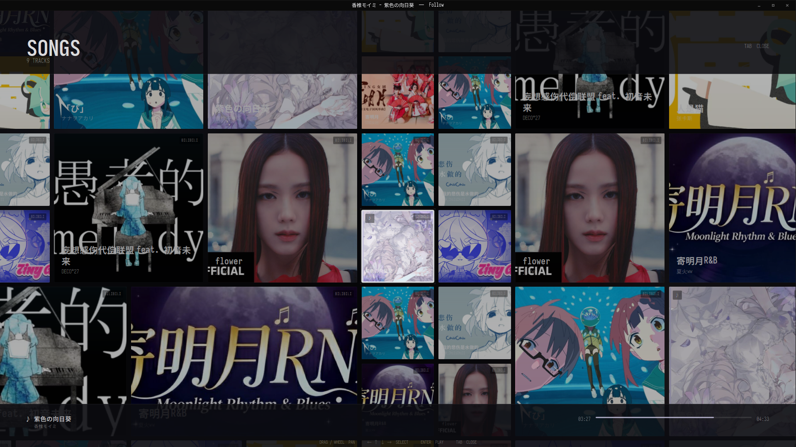
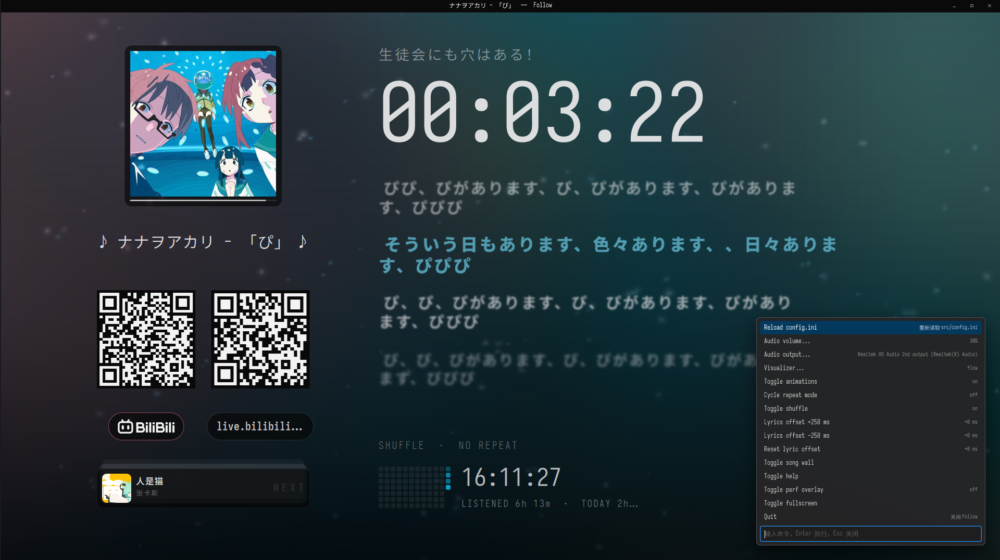

<div align="center">


# Follow

**一个把「正在听什么」摆到屏幕上给观众看的极简音乐播放器。**

</div>


## 开始使用

需要 GTK 4、libepoxy、FFmpeg、libcurl、JSON-GLib、libqrencode、librsvg，以及一个 C 编译器。

```sh
# MSYS2 / MinGW-w64
pacman -S mingw-w64-x86_64-toolchain mingw-w64-x86_64-gtk4 \
          mingw-w64-x86_64-libepoxy mingw-w64-x86_64-libqrencode \
          mingw-w64-x86_64-curl

# MSYS2 / UCRT64
pacman -S mingw-w64-ucrt-x86_64-toolchain mingw-w64-ucrt-x86_64-gtk4 \
          mingw-w64-ucrt-x86_64-libepoxy mingw-w64-ucrt-x86_64-qrencode \
          mingw-w64-ucrt-x86_64-curl

# Debian / Ubuntu
sudo apt install build-essential pkg-config libgtk-4-dev libepoxy-dev \
     libqrencode-dev libcurl4-openssl-dev libjson-glib-dev librsvg2-dev \
     libavformat-dev libavcodec-dev libswresample-dev libavutil-dev
```

```sh
make          # 产物是 ./main.exe
./main.exe    # 在项目根目录跑：资源路径是相对的
```

配置文件是 `src/config.ini`（[GKeyFile](https://docs.gtk.org/glib/struct.KeyFile.html) 格式，手写），改完在命令面板里 `Reload config.ini` 即可。最小示例：

```ini
[window]
width=1920
height=1080
title=Follow

[qrcode]
link=https://github.com/clevebitr/follow/          # 墙钟下方的二维码链接

[visualizer]
effect=dust                                        # off / dust / warp / flow

[audio1]
link=src/assets/xxx.mp3                             # 本地路径或 http(s) URL
title=bgm
artist=artist1
pic=src/assets/bgm.jpg                              # 封面：本地路径或 URL
lrc=netease:bgm artist1                             # 本地 .lrc / netease:... / qq:...

[audio2]
link=https://www.bilibili.com/video/BV1GJ411x7h7    # B 站页面链接会自动解析

[audio3]
link=https://www.youtube.com/watch?v=YudHcBIxlYw    # YouTube 同样会解析（需代理）
```

`[audioN]` 按 N 排序就是播放列表，任何一项缺失都会回落到默认值，ini 写坏了也能启动。**完整键说明见下方「配置项」**。

> YouTube 按出口 IP 判人机验证：机房 IP / 公共代理常被挡，`[net] proxy` 对 YouTube 基本必填。
> 另外 googlevideo 只接受定长 Range 请求，YouTube 音源改由 `src/core/httpstream.c` 用 libcurl 分块拉流再喂给解码器（seek 仍然正确），这是实现细节，不用管。

## 功能

### 播放

- 本地文件、`http(s)` 直链、HLS（FFmpeg 解码）
- Bilibili / YouTube 链接直接粘：`BV` 号、`av` 号、`b23.tv` 短链、`youtu.be`、`watch?v=` / `shorts` / `music.youtube.com` 都自动解析音频轨
- 播放 / 暂停 / 停止 / 拖动进度 / 上一首下一首
- 循环（关 · 列表 · 单曲）、随机（带历史，「上一首」能回去）、自动续播
- 音量 / 静音 / 输出设备在命令面板里调，状态会记住
- 全键盘操作，没有按钮也没有菜单

### 画面

- 动态背景：封面模糊打底 + 三团从封面取样的种子色缓慢漂移，随换曲换色
- 音频粒子背景：`[visualizer] effect = dust / warp / flow` 三套预设，采样真实播放的音频做 1024 点 FFT，低 / 中 / 高频分别驱动粒子的速度、大小和亮度，颜色取自封面
- 换曲过渡：旧背景左移退场，新组件从右侧推入，两层刻意不同步
- 自适应版面：字号和位置按窗口尺寸算，窗口变窄自动收版，时钟太长自动缩字号
- 字体：界面 Iosevka + Noto Sans SC，只有时间用手写体

### 歌词

- 支持标准 LRC（`[mm:ss.xx]`、`[offset:]`、一行多时间戳、行内 `<mm:ss.xx>`）
- 自动识别编码（GB18030 老 LRC 也能读）；没写 `lrc=` 就在音频旁找同名 `.lrc`
- 在线歌词：`lrc=netease:...` / `lrc=qq:...`，取回带时间轴的歌词并缓存；会检查音频与歌词时长是否匹配，差太多提示换源
- 歌词偏移：`[` / `]` 边听边调 250ms，`\` 复原
- 排版固定四列（预推出列 / 当前句 / 预演一 / 预演二），超长句按区域宽度自动分段、逐行绘制
- 当前句用封面种子色高亮，其它行白字；带词级时间戳的歌词（网易云 `yrc`、增强 LRC）做逐字扫描，否则整行一起亮
- 歌词层走 `GtkGLArea`，无 OpenGL 3.3 时自动回退 cairo（只画当前行 + 下一行），也可用 `FOLLOW_LYRICGL=0` 强制

### 歌曲墙

- `Tab` 打开全屏歌曲墙：`12 × 8` block 模板向四周无限重复，每个新 block 随机换模板 / 翻转 / 打乱曲序，拖到哪都有内容
- 鼠标左键拖动（松手带惯性），滚轮 / 触摸板双指平移；拖完自动把焦点落到视野内最近的磁贴
- 墙层走 `GtkGLArea`，cairo 只预渲染纹理，平移 / 选中弹出 / 压暗 / 淡入由 GPU 合成；不支持 OpenGL 3.3 时整屏回退 cairo，也可用 `FOLLOW_WALLGL=0` 强制
- 整屏置色：底色 + 两团来自选中封面的径向柔光，顶栏 / 底栏同色相实心色衬；封面未加载时保持上一色，不闪黑
- 封面磁贴：大封面 + 底部渐变标题 / 艺人 + 右上角平台角标；当前曲目左侧强调条 + `♪`，选中的磁贴白色描边
- 进场 / 退场、磁贴弹出、封面淡入可用 `[ui] animations = false` 整体关掉
- 空位用低对比度 `FOLLOW` 装饰磁贴补齐；开关键、关闭键和所有播放快捷键都能在 `[keys]` 里改

### 二维码

- 网络曲目自动生成一张，下面挂各家官方字标（BILIBILI / APPLE MUSIC / YOUTUBE / SPOTIFY / SOUNDCLOUD / BANDCAMP）
- 本地曲目不显示；`[qrcode] link` 是网络地址时并排再生成一张，两张尺寸与胶囊高度一致

### 统计

- 左下角显示墙钟、累计收听时长、今日收听时长
- 近 12 周热力图，颜色取自当前封面；按天记在 `<cache>/follow/stats.dat`，纯文本可改

### 命令面板

`Ctrl+Shift+P` 打开 VSCode 风格命令框，可执行：`Reload config.ini`、`Audio volume...`（±5% / 50% / 100% / 静音）、`Audio output...`（切换播放设备）、`Visualizer...`、`Toggle animations`、`Cycle repeat mode`、`Toggle shuffle`、`Lyrics offset` 调整 / 复位、开墙、帮助页、全屏、退出。音量 / 静音 / 输出设备写在 `<cache>/follow/settings.ini`，与 `config.ini` 分开，重载 ini 不会冲掉。

## 快捷键（默认）

| 按键 | 作用 |
|---|---|
| `Ctrl+Shift+P` | 打开 / 关闭命令面板 |
| `Space` | 播放 / 暂停（还没放歌时从第一首开始） |
| `←` / `→` | 后退 / 前进 5 秒（按住 `Shift` = 30 秒） |
| `N` / `P` | 下一首 / 上一首 |
| `R` | 当前曲目从头重放 |
| `S` | 停止 |
| `L` | 循环：关 → 列表 → 单曲 |
| `H` | 随机播放开关 |
| `[` / `]` | 歌词提前 / 延后 250 ms |
| `\` | 歌词偏移恢复成 ini 里的值 |
| `F` / `F11` | 全屏 |
| `Tab` | 打开 / 关闭歌曲墙 |
| `F1` | 快捷键页 |
| `F12` | 性能检测层 |
| `Q` | 退出 |
| `Esc` | 关掉歌曲墙 / 快捷键页 / 退出全屏 |

所有动作都可以在 `[keys]` 里改，用逗号分隔多个键；`F1` 打开的快捷键页会显示当前实际绑定。

## 技术栈

**GTK 4 只负责窗口和输入，整屏画面自己用 cairo 画；音频用 miniaudio 输出、FFmpeg 解码。**

| 组件 | 用途 |
|---|---|
| C + GLib | 全部代码 |
| GTK 4 | 窗口、GtkPicture 纹理放大、CSS、GtkGLArea |
| cairo + Pango | 整屏绘制与排版；歌曲墙磁贴预渲染成纹理 |
| OpenGL 3.3 + libepoxy | 墙层 textured quad、相机平移 / 选中缩放 / 压暗在 GPU 上合成 |
| miniaudio | 音频输出（已内置，header-only） |
| FFmpeg | 本地 / 网络音频解码 |
| libcurl + JSON-GLib | 网络请求与接口解析（B 站 / YouTube / 歌词源）、YouTube 分块拉流 |
| libqrencode + librsvg | 二维码与品牌矢量图标 |
| 自带 FFT | 可视化用的 1024 点 radix-2 FFT，不依赖 FFTW / libvisual |

## 目录结构

```
src/core/    播放器内核：配置、解码与输出、音源解析、歌词、封面取色、收听统计
src/ui/      画面：版面计算、cairo 绘制、动态背景 / 粒子、歌曲墙、二维码、快捷键页
src/icons/   品牌字标 + 项目 logo
src/style/   GTK 外壳样式（窗口底色 + 极细的标题栏）
src/assets/  示例音频与封面（不入库，按 config.ini 放自己的文件）
src/models/  内置的 miniaudio.h
crates/      gtk-mcp-agent-capi：把 uidbg 调试通道包成 MCP 工具（make mcp）
```

## 免责声明 / Disclaimer

**本项目仅供学习与技术研究使用。**

- 作者**不提供、不托管、不分发**任何音视频内容。播放的内容全部由使用者自己提供或指定，版权归各自权利人所有。
- `src/core/bilibili.c` 使用 B 站网页端的**非公开接口**并附带 Referer 头来获取音频流地址；`src/core/youtube.c` 调用 YouTube 的 InnerTube 接口并伪装成官方客户端；`src/core/lyricsrc.c` 同理访问网易云 / QQ 音乐。这些做法**可能违反对应平台的服务条款**，接口也可能随时失效。**请仅用于个人学习，不要用于分发、转售或商业用途，也不要下载 / 保存 / 二次分发内容。**
- 若需要合规使用，请走各平台官方开放接口，或直接使用你有权访问的音频直链（`http(s)` / HLS）——这条路径不涉及任何平台。
- 使用者须自行遵守所在地法律法规与平台条款，**因使用本项目产生的一切后果由使用者自行承担**。

> This project is for **learning and research only**. It hosts no media content. Third‑party services are accessed through undocumented endpoints and may violate their Terms of Service. Use at your own risk; the author takes no responsibility for any consequences.

## 配置项

| 组 | 键 | 说明 |
|---|---|---|
| `window` | `width` / `height` / `fullscreen` / `title` | 缺省 800×600、窗口模式、`Follow` |
| `note` | `text` | 时钟上面那行副标题；空则这一行让给歌词 |
| `playback` | `repeat` / `shuffle` | `off` / `all`（默认）/ `one`，随机默认关 |
| `qrcode` | `link` / `label` | 只对 `http(s)` 地址显示；`label` 默认取主机名 |
| `cache` | `dir` / `resolve_ttl` / `cover_max_mb` | 缓存目录（默认 `<用户缓存>/follow`）；解析缓存时长（秒，默认 2700，0 = 关闭）；封面缓存上限（MB，默认 128） |
| `ui` | `animations` / `backdrop_fps` | 动效总开关；动态背景刷新率（10–240，默认 30） |
| `net` | `user_agent` / `timeout` / `connect_timeout` / `proxy` | UA 留空用内置浏览器 UA，超时单位秒，`proxy` 同时作用于 curl 与 FFmpeg |
| `visualizer` | `effect` / `particles` / `gain` | `off` / `dust`（默认）/ `warp` / `flow`，粒子数 20–400，灵敏度 0.2–4.0 |
| `keys` | 动作名 | 按键绑定，值可写多个键（逗号 / 竖线分隔），`off` / `none` 解绑；键名用 GDK 名字，支持 `ctrl+` / `alt+` / `shift+` / `super+` |
| `audioN` | `link` | **必填**，空的组会被跳过 |
| | `title` / `artist` / `note` / `pic` / `lrc` / `lrc_offset` / `page` / `platform` | 曲目元数据、封面、歌词来源、二维码目标与平台徽标 |

---
## 画廊
### 歌曲墙  


### 命令面板  


## 致谢
项目歌词实现参考自：[applemusic-like-lyrics](https://github.com/amll-dev/applemusic-like-lyrics)  
项目歌曲墙实现参考自：[folia-major](https://github.com/chthollyphile/folia-major)  
部分ui界面参考自：[tsoding](https://github.com/tsoding)

## 附录

### A. 性能与硬件加速

- **Windows 默认启用 DirectComposition**：GTK 4.24 的 Win32 后端默认不创建 DComp 设备，GSK 会退回 cairo 软件合成，2K 全屏时每帧都要把 GL 纹理读回内存。程序启动时自动往 `GDK_DEBUG` 追加 `dcomp`，让 GSK 走 GL 渲染器；驱动不支持时 GTK 会自行回退。想强制关闭可设 `FOLLOW_DCOMP=0` 或 `GSK_RENDERER=cairo`。
- **主画布按需重绘**：歌词在 GPU 层逐字推进时，主画布（时钟 / 封面 / 统计）不再每帧重新记录。实测播歌从 ~34fps 回到 ~50fps 以上，CPU 占用减半。
- **歌曲墙 / 动态背景 / 歌词**各 GL 层打不开 OpenGL 3.3 时都会自动回退到对应的 cairo 路径，也可用 `FOLLOW_WALLGL` / `FOLLOW_BACKDROPGL` / `FOLLOW_LYRICGL` 单独强制。
- 封面解码、磁贴纹理生成放到后台线程 / 低优先级队列；2K / 4K 上磁贴按设备像素渲染，打开墙不再同步卡住。
- Windows 下窗口不用 CSD 的 12px 阴影（DComp 会把透明阴影区画成黑边），改为 1px 细边，标题栏用 `GtkWindowHandle` 拖动，四边自定义缩放，DWM 圆角 / 边框关闭。
- **性能检测层**：`F12`（或命令面板 `Toggle perf overlay`）在左上角叠加面板，显示合成帧率 / 帧间隔（avg · p95 · 最慢）/ 各渲染层 CPU 耗时与每秒调用次数 / 纹理上传量。帧时间取自 `GdkFrameClock::after-paint`，是「真的合成了一帧」的时刻。`FOLLOW_PERF=1` 启动即打开。
- **面板读数**：按需重绘，没有固定帧率。静止时只有动态背景在动（默认 30fps），面板稳定在 26–30；拿到逐字时间轴歌词时升到约 40；歌曲墙打开时只有一层不透明 GLArea，能到约 137fps（`GdkFrameClock` 上限）。

### B. 环境变量与调试开关

| 变量 | 作用 |
|---|---|
| `FOLLOW_DCOMP=0` | 关闭自动追加的 `dcomp`，可配合 `GSK_RENDERER=cairo` 强制软件渲染 |
| `FOLLOW_BACKDROPGL=0` | 动态背景回退到 CPU 小纹理 + `GtkPicture` |
| `FOLLOW_WALLGL=0` | 歌曲墙回退到整屏 cairo |
| `FOLLOW_LYRICGL=0` | 歌词层回退到 cairo（只画当前行 + 下一行） |
| `FOLLOW_PERF=1` | 启动即打开性能检测层 |
| `FOLLOW_WALL_DEBUG=1` | 打印墙的帧率 / 帧时间 / 纹理上传数 |
| `FOLLOW_WALL_AUTO=1` | 启动后自动开墙 |
| `FOLLOW_EXIT_MS=8000` | 定时退出（毫秒） |
| `FOLLOW_WALL_AUTO_PAN=1` | 持续平移 |
| `FOLLOW_WALL_AUTO_CLOSE` / `FOLLOW_WALL_AUTO_REOPEN` | 复现「开墙 → 关墙 → 再开墙」的性能问题 |
| `FOLLOW_PALETTE_AUTO=1` | 自动打开命令面板 |
| `FOLLOW_PALETTE_QUERY=vol` | 预填命令面板查询 |
| `FOLLOW_UIDBG=1` | 开启 MCP 调试通道（默认 7878） |
| `FOLLOW_UIDBG_PORT=7900` | 指定 MCP 调试端口 |

### C. 歌词渲染与动画实现

- 背景模糊为 9 抽头高斯，σ 随动画连续变化，边缘无块状感
- 待演出行两档：预演一 `94%` + `blur(1.4px)` + 72% 不透明度；预演二 `90%` + `blur(4.2px)` + 45% 不透明度
- 预推出列：`95%` + `blur(1px)` + 58% 不透明度，唱完挂到当前句上方
- 新出现的待演出行从目标位置下方 1.6em 浮上来，0.22s 时间常数淡入，配合区域底部渐隐
- 轮到演唱：先原地缩到 `88%`（0.12s，位置不动），再上滑到演出行，同时带少量回弹放大到 `112%`、模糊清零
- 预推出列离场：0.09s 内缩到 `90%` 并加重模糊，再滑出淡出，0.2s 走完
- 每往下一行起跑晚 50ms（交错弹簧），上滑补位时间隙先被拉开再收回
- 字形遮罩与逐字时间坐标遮罩都在 GPU 上合成，模糊用 mipmap LOD，无辉光

### D. Agent 调试（MCP）

调界面时最贵的一步是截图。应用里留了一条调试通道，把「屏幕上画了什么」变成结构化文本；不带 `FOLLOW_UIDBG` 启动时 `uidbg_*` 全是空调用，不开端口。

```sh
make            # 应用
make mcp        # 生成 build/gtk-mcp-agent.exe
FOLLOW_UIDBG=1 ./main.exe          # 开调试通道（默认 7878）
```

MCP 服务已写进仓库的 `.pi/mcp.json`（server 名 `follow-ui`），pi 里 `/reload` 后生效；其他客户端当 stdio MCP 跑即可。

| 工具 | 作用 |
|---|---|
| `ui_state` | 视图 / 播什么 / 进度 / 音量 / 输出设备 / 歌词行 / GL 层 / 帧时间 |
| `ui_screen` | 这一帧画了哪些文字（坐标、字号、颜色、层级）+ GTK 控件；`contains` / `layer` 过滤 |
| `ui_key` | 注入按键，命令面板开着时走面板自己的选中逻辑 |
| `ui_click` | 按坐标点，或 `contains` 先找文字再点它的中心 |
| `ui_scroll` | 歌曲墙平移 / 滚轮 |
| `ui_type` | 往命令面板输入框写字 |
| `ui_logs` | 最近 `g_log`（解析缓存命中、歌词来源、播放错误…） |
| `ui_perf` | `render_ms`、重画间隔、GSK 渲染器、GL 三层是否可用 |
| `ui_screenshot` | 兜底：按 `max_width` 缩放后返回 PNG，默认整窗 720 宽 |
| `ui_wait` | 等某个状态出现（画面出现某段文字 / 视图变了 / 播放状态变了） |
| `ui_launch` | 带 `FOLLOW_UIDBG=1` 启动 `main.exe` 并等通道就绪 |

已知限制：`ui_screenshot` 走 GSK 的软件节点渲染，`GtkGLArea` 那几层（歌曲墙磁贴、歌词层）有时截不到——正好这些用 `ui_screen` / `ui_state` 看更准。

### E. Roadmap

**P1 — 性能**

- [ ] 主画布换纹理节点：每帧 GSK 都会重新栅格化 cairo 节点（1080p 约 10ms），改成 ARGB32 图面 + `GdkTexture` + `gtk_snapshot_append_texture()`，内容变了才重建（实测对照：隐藏主画布后 25.6fps → 37.6fps）
- [ ] 主画布一次重画 ~6ms：`theme_text_draw` 每次重建 PangoLayout，可做 LRU 排版缓存
- [ ] 墙打开时空转：`wallgl` tick 常驻，静止时也会把 frame clock 拉到刷新率
- [ ] CPU 背景回退 13.4ms/次 × 23 次/秒 ≈ 32% 单核：`backdrop_push` 可复用纹理 / 降尺寸
- [x] `[ui] animations = false` 时直接 snap
- [ ] 可选降低磁贴缓存分辨率 / 限制同屏数量
- [x] 封面磁盘缓存 + 上限清理、淡入 / 按尺寸缓存 / 磁贴内容缓存
- [ ] 同一封面并发请求合并；`[cache] audio = true` 可选音频文件缓存（后台下载、YouTube 定长 Range、上限清理、sidecar 元数据、损坏回退）

**P2 — 歌曲墙体验**

- [ ] 滚轮结束后焦点落到最近磁贴（拖动已做）
- [ ] 单击磁贴立即播放并返回；双击 / 中键行为确认
- [ ] 键盘空间导航边界：focus 在屏外时方向键落点、PageUp / PageDown 目标、Home / End 最近实例
- [ ] 触摸板双指平移
- [ ] 长标题 / 小尺寸磁贴的省略与排版
- [ ] 窗口 resize 后 focus / camera 重新对中

---